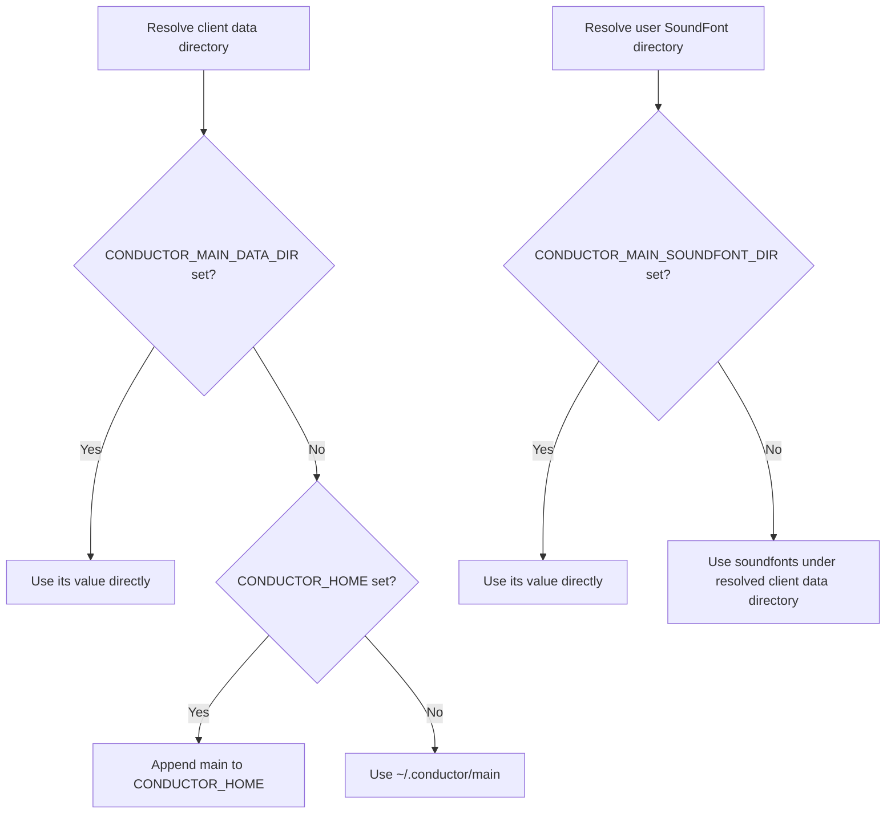

# Audio & Data Management

## Data Directory

Conductor applications share a single user-accessible data root. By default, this client owns the `main` directory below that root:

```text
~/.conductor/main/
├── generations/       # retained MIDI, audio, messages, and metadata
├── Prompts/           # durable prompt overrides
└── soundfonts/         # user-supplied SoundFonts
```

On Windows, `~` normally expands to `%USERPROFILE%`, so the same location is `%USERPROFILE%\.conductor\main`. These files survive repository, virtual environment, and package replacement. Back up `Prompts` and any user-supplied SoundFonts as durable user data. Generation history is kept until you delete it through the History sidebar, so remove old entries there when reclaiming space.

### Location Precedence

1. `CONDUCTOR_MAIN_DATA_DIR` selects this client's complete data directory;
2. `CONDUCTOR_HOME` selects the shared suite root and this client appends `main`;
3. the default is `~/.conductor/main`.

`CONDUCTOR_MAIN_SOUNDFONT_DIR` independently overrides only the directory used for user-supplied SoundFonts. For example, PowerShell users can relocate the whole suite or just this client:

```powershell
$env:CONDUCTOR_HOME = "D:\ConductorData"
$env:CONDUCTOR_MAIN_DATA_DIR = "D:\ConductorData\custom-main"
$env:CONDUCTOR_MAIN_SOUNDFONT_DIR = "D:\Music\SoundFonts"
```

The most specific variable wins. Relative paths remain relative to the process working directory, while paths beginning with `~` expand to the user home.



## SoundFonts and Audio Playback

The app discovers packaged and user-available `.sf2` SoundFonts through Core. Core ships the default SoundFont; drop additional `.sf2` files into the `~/.conductor/main/soundfonts/` directory (or the directory set by `CONDUCTOR_MAIN_SOUNDFONT_DIR`) to make them selectable.

Audio rendering requires all of the following:

1. FluidSynth installed and available on `PATH`;
2. FFmpeg with MP3 encoding support installed and available on `PATH`;
3. An available SoundFont.

Core gives FluidSynth synthesis and FFmpeg encoding 5 seconds each before reporting a rendering error.

Use **Refresh SoundFonts** after adding a SoundFont while the app is running. Select a different SoundFont and click **Re-render Audio** to audition the current MIDI without regenerating it or making another provider call. Playback repeats automatically so the four-bar loop can be auditioned continuously.

If the audio toolchain is unavailable, MIDI generation still succeeds. The app shows the setup problem and leaves playback empty.

Re-rendering saved audio uses Core's staged commit so a failed render or a confirmed rollback preserves the previous audio and SoundFont metadata. Each successful re-render is saved under a new timestamped name, such as `loop-20261120_153012_123456.mp3`, so the player loads the new file instead of a cached copy. Core removes the replaced file after recording the new one; on Windows, a file still held open is removed on the next re-render instead. Errors appear in the UI.

If both the commit and rollback fail, the app clears playback and saved-SoundFont state and disables re-rendering for that generation for the rest of the running app process, including when selected from history again. MIDI remains available. Status shows "Audio recovery is required. MIDI is still available." followed by the recovery folder retained by Core. Refreshing SoundFonts preserves that warning and keeps re-rendering disabled. Ordinary render failures and successful rollbacks remain retryable when the audio toolchain is available. Core leaves the saved audio and metadata untouched; the recovery folder holds only the metadata that was not promoted, and Core removes the unreferenced new MP3 on the next successful re-render. Restart the app to re-render that generation again.

## History and Saved Generations

Click **History** to open the recent-generation sidebar. From there you can:

- Select a generation from the list to restore it immediately. The selected row stays highlighted, and the status shows when loading succeeds. Generating a new loop clears the history selection;
- Click **Delete...** to replace the action buttons with **Confirm Delete** and **Cancel**. Select another entry, click **Cancel**, or hide the sidebar to restore the usual buttons; confirm to remove the selected generation and its saved files;
- **Refresh** the newest-first list after external changes. Selection remains if the generation still exists;
- Inspect each entry on three lines: key, scale, and timestamp; model and reasoning setting; and the prompt, shortened with an ellipsis when it does not fit.

Selecting an entry replaces the current audio, visualization, prompt, and generation controls, including unsaved edits. To restore the selected entry after editing controls, select another entry and then select it again. Selecting an entry for deletion also loads it; confirming deletion clears it from the main view.

The app keeps every generation under its data directory until you delete it:

```text
~/.conductor/main/generations/
└── gen_<id>/
    ├── loop.mid
    ├── loop.mp3        # first render; re-renders use loop-<timestamp>.mp3
    ├── messages.json
    └── metadata.json
```

Loading history restores its MIDI, saved audio, visualization, generation ID, SoundFont metadata, loop parameters, provider, model, temperature, and reasoning controls. The restored controls remain editable, so a historical setup can be adjusted before generating again.

Older history entries that did not record reasoning settings use the current model defaults and show a warning. Entries recorded with reasoning off on a model with effort levels restore that model's lowest level, which is what was sent. Saved providers or models that are no longer available remain visible with an unavailable label instead of being silently replaced. Missing SoundFonts are also identified while saved audio remains available.

For Ollama history, the app checks the local service before marking the saved provider or model unavailable, then restores reasoning controls from the capabilities Core reports for that model.
